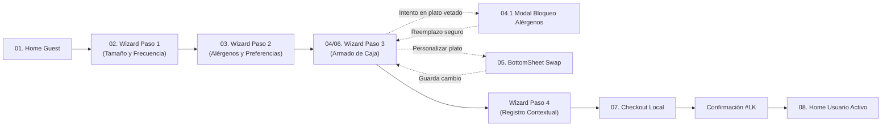

# ListoBox PWA — Suscripción Semanal de Meal-Kits


> **Tu semana gourmet sin esfuerzo.** Prototipo funcional de Progressive Web App (*Mobile-First*) para suscripción flexible de kits de ingredientes frescos dosificados al gramo y recetas listas en 20–25 minutos, adaptado al mercado colombiano.

---

## Tabla de Contenidos

- [Descripción General y Propuesta de Valor](#-descripción-general-y-propuesta-de-valor)
- [Características Principales (MVP)](#-características-principales-mvp)
- [Recorrido de Pantallas y Flujos de Usuario](#-recorrido-de-pantallas-y-flujos-de-usuario)
- [Stack Tecnológico](#-stack-tecnológico)
- [Arquitectura y Estructura del Proyecto](#-arquitectura-y-estructura-del-proyecto)
- [Sistema de Diseño y Tokens](#-sistema-de-diseño-y-tokens)
- [Requisitos Previos e Instalación](#-requisitos-previos-e-instalación)
- [Scripts Disponibles](#-scripts-disponibles)
- [Reglas de Negocio y Estándares de Ingeniería](#-reglas-de-negocio-y-estándares-de-ingeniería)
- [Documentación de Referencia](#-documentación-de-referencia)

---

## Descripción General y Propuesta de Valor

**ListoBox** resuelve la fatiga mental de planificar cenas semanales, hacer compras en supermercados y desperdiciar alimentos frescos. A diferencia de las plataformas de suscripción rígidas que bloquean al usuario con un muro de registro o pago antes de mostrar el catálogo, ListoBox implementa una arquitectura **Value-First (*Guest Mode*)**:

1. **Exploración Libre sin Fricción:** El usuario explora todo el menú semanal, filtra por categorías dietéticas y calibra su plan sin crear una cuenta primero.
2. **Seguridad Alimentaria Crítica:** Motor síncrono de detección de alérgenos que bloquea visual y funcionalmente platos de riesgo vital y sugiere sustitutos seguros en un toque.
3. **Personalización Modular (*Swap Engine*):** Intercambio de proteínas y guarniciones en máximo 2 taps con actualización optimista (*Optimistic UI*) y cálculo transparente en pesos colombianos (`COP`).
4. **Transición Contextual y Pagos Locales:** Conversión fluida de invitado a suscriptor conservando el estado de la caja en `localStorage`, seguida de checkout con métodos de pago colombianos (**PSE**, **Nequi**, **Daviplata** y **Tarjetas**) y pausa semanal (*Skip Week*) en 1 tap.

---

## Características Principales (MVP)

| Módulo | Descripción Funcional | Historia PRD |
| :--- | :--- | :---: |
| **Modo Invitado (*Guest-First*)** | Navegación irrestricta del catálogo semanal, calculadora de porciones y preguntas frecuentes sin *login wall*. | `HU-01` |
| **Configurador Progresivo (Wizard)** | Calibración paso a paso de comensales (`1`, `2`, `4`, `6`), recetas por semana (`3`, `4`, `5`), afinidad proteica y tiempos de cocción. | `HU-01` |
| **Bloqueo Preventivo de Alérgenos** | Cruce síncrono entre los alérgenos vetados del usuario y las recetas. Renderiza estado `Locked-Allergen` y despliega el **Modal Intrusivo de Seguridad**. | `HU-02` |
| **Motor de *Swap* de Ingredientes** | *Bottom Sheet* interactivo para sustituir proteínas o guarniciones con recálculo instantáneo de calorías y sobrecostos en `COP`. | `HU-03` |
| **Sticky Dock de Progreso** | Barra inferior persistente con indicadores visuales de cupo (`ej. 3 de 3 recetas`), validación de inventario y activación condicional del CTA. | `HU-04` |
| **Registro Contextual (*Guest-to-User*)** | Alta rápida en 1 tap (Google, WhatsApp o celular) al completar la caja, preservando íntegramente la selección previa. | `HU-05` |
| **Checkout y Pasarela Local** | Captura de dirección urbana, franja horaria de entrega, notas de portería y pago recurrente simulado con **PSE, Nequi, Daviplata o Tarjeta**. | `HU-06` |
| **Confirmación & Home Activo** | Generación de orden `#LK-xxxxx`, fecha de corte semanal (*cut-off*) y panel de suscriptor con función **Pausar Semana (*Skip Week*)**. | `HU-07` |

---

## Recorrido de Pantallas y Flujos de Usuario

El prototipo implementa un flujo de navegación completo gestionado por estado reactivo en cliente (`ListoBoxContext`) y respaldado por las referencias visuales oficiales en `docs/figma-refs/`:



### Detalle de Vistas Implementadas (`src/components/screens/`)
* **`HomeGuestScreen.tsx`**: Hero principal, propuesta de valor en 3 pasos, carrusel de menú semanal con filtros dietéticos, calculadora interactiva de precio por porción, testimonios y acordeón de FAQ.
* **`WizardStep1Screen.tsx`**: Selector de cantidad de personas, frecuencia semanal de comidas y resumen financiero dinámico con envío gratis en la primera entrega.
* **`WizardStep2Screen.tsx`**: Matriz de exclusión de alérgenos críticos (Mariscos, Maní, Lácteos, Gluten, Soya, Huevo, Nueces, Pescado), afinidad de proteínas y preferencia de tiempo en cocina.
* **`WizardStep3Screen.tsx`**: Catálogo facetado por dieta con tarjetas en 5 estados (*Default*, *Selected*, *Swapped*, *Locked-Allergen*, *Skeleton*) y barra inferior `StickyBoxDock`.
* **`WizardStep4Screen.tsx`**: Paso de vinculación rápida de cuenta antes del pago sin pérdida de estado.
* **`CheckoutScreen.tsx`**: Formulario logístico, desglose transparente de facturación y selector de pasarela local colombiana.
* **`CheckoutSuccessScreen.tsx`**: Comprobante de orden aprobada, cronograma de entrega y recordatorio de fecha límite de modificación (*cut-off*).
* **`HomeActiveScreen.tsx`**: Dashboard del suscriptor activo con estado de envío, gestión del menú de la semana, pausa de suscripción en 1 clic (*Skip Week*) y acceso al recetario paso a paso.

---

## Stack Tecnológico

* **Framework Principal:** [Next.js 15.3](https://nextjs.org/) (App Router)
* **Librería UI:** [React 19](https://react.dev/) (Client & Server Components)
* **Lenguaje:** [TypeScript 5.7](https://www.typescriptlang.org/) (Modo estricto, tipado estático integral sin `any`)
* **Estilos y Tokens:** [Tailwind CSS v4.1](https://tailwindcss.com/) con arquitectura *CSS-First* (`@import "tailwindcss";` y directiva `@theme` en `src/app/globals.css`)
* **Tipografía:** `Plus Jakarta Sans` optimizada mediante `next/font/google`
* **Iconografía:** Exclusivamente [`@phosphor-icons/react`](https://phosphoricons.com/) con pesos (`regular`, `bold`, `fill`, `duotone`) y dimensiones explícitas
* **Estado y Persistencia:** React Context + `useReducer` con sincronización automática en `localStorage` (`listobox_mvp_state_v2`)

---

## Arquitectura y Estructura del Proyecto

```text
pwa_listobox/
├── AGENTS.md                                  # Reglas de arquitectura, UI y fidelidad visual
├── README.md                                  # Documentación principal del repositorio
├── next.config.ts                             # Configuración de Next.js y dominios de imágenes
├── package.json                               # Dependencias y scripts del proyecto
├── postcss.config.mjs                         # Configuración PostCSS para Tailwind CSS v4
├── tsconfig.json                              # Configuración estricta de TypeScript
├── public/
│   └── manifest.json                          # Web App Manifest para instalación PWA
├── docs/
│   ├── DESIGN.md                              # Sistema de diseño, paleta y escala tipográfica
│   ├── PRD.md                                 # Documento de Requerimientos de Producto (V2.0)
│   └── figma-refs/                            # Capturas de referencia UI (01 a 08)
└── src/
    ├── app/
    │   ├── fonts.ts                           # Configuración de Google Fonts (Plus Jakarta Sans)
    │   ├── globals.css                        # Definición de @theme, tokens y utilidades Mobile-First
    │   ├── layout.tsx                         # Root Layout, metadatos PWA y Provider global
    │   └── page.tsx                           # Orquestador de pantallas, modales y Bottom Sheets
    ├── components/
    │   ├── screens/                           # Vistas completas del flujo (Guest, Wizard, Checkout, Active)
    │   │   ├── CheckoutScreen.tsx
    │   │   ├── CheckoutSuccessScreen.tsx
    │   │   ├── HomeActiveScreen.tsx
    │   │   ├── HomeGuestScreen.tsx
    │   │   ├── WizardStep1Screen.tsx
    │   │   ├── WizardStep2Screen.tsx
    │   │   ├── WizardStep3Screen.tsx
    │   │   └── WizardStep4Screen.tsx
    │   └── ui/                                # Componentes atómicos y modulares reutilizables (DRY)
    │       ├── AllergenBlockModal.tsx         # Modal intrusivo de seguridad médica
    │       ├── BadgePill.tsx                  # Etiquetas semánticas y nutricionales
    │       ├── BottomNav.tsx                  # Barra de navegación inferior fija (4 tabs)
    │       ├── BoxProgressSummary.tsx         # Indicador visual de slots de la caja
    │       ├── CategoryFilterPills.tsx        # Segmentador horizontal de categorías dietéticas
    │       ├── FaqAccordion.tsx               # Acordeón interactivo de preguntas frecuentes
    │       ├── GhostLink.tsx                  # Enlaces de acción secundaria con icono
    │       ├── IngredientSwapSheet.tsx        # Bottom Sheet de intercambio de proteínas y guarniciones
    │       ├── MobileShell.tsx                # Contenedor ergonómico móvil (max-w-md, safe-areas)
    │       ├── PillButton.tsx                 # Botones píldora primarios y secundarios (min 44x44px)
    │       ├── PullToRefreshContainer.tsx     # Gesto táctil simulado de actualización
    │       ├── RecipeCard.tsx                 # Tarjeta dinámica de receta (5 estados)
    │       ├── SectionHeader.tsx              # Encabezados de sección estandarizados
    │       ├── SelectableCard.tsx             # Tarjetas de selección para el Wizard
    │       ├── StickyBoxDock.tsx              # Barra flotante de progreso y subtotal en COP
    │       ├── TopNav.tsx                     # Barra superior contextual
    │       └── WizardProgressBar.tsx          # Indicador de progreso de pasos del configurador
    ├── context/
    │   └── ListoBoxContext.tsx                # Estado global (useReducer), lógica de negocio y persistencia
    ├── mocks/
    │   └── listoboxData.ts                    # Catálogo de recetas, alérgenos, precios COP y FAQs
    └── types/
        └── listobox.ts                        # Contratos e interfaces TypeScript del dominio
```

---

## Sistema de Diseño y Tokens

El sistema visual combina una estética orgánica tipo *farm-stand* con tipografía moderna de alto contraste. Todos los tokens están centralizados en `src/app/globals.css` bajo la directiva `@theme` de **Tailwind CSS v4**:

| Token CSS | Valor Hex | Rol en la Interfaz |
| :--- | :---: | :--- |
| `--color-cream-canvas` | `#f4f3e7` | Superficie principal de página (fondo cálido orgánico) |
| `--color-deep-forest` | `#00473c` | Color primario de marca, navegación, bordes activos y textos de énfasis |
| `--color-lime-glow` | `#e6ff55` | Acento de alta energía para CTAs principales, badges e indicadores activos |
| `--color-sage-mist` | `#d8e5d6` | Superficie botánica suave para bloques informativos y secciones alternas |
| `--color-warm-sand` | `#e8dcc6` | Superficie cálida secundaria para tarjetas, divisores y contenedores |
| `--color-forest-shadow` | `#0e150e` | Texto primario de máximo contraste y bordes estructurales |
| `--color-danger-red` | `#dc2626` | Alertas médicas críticas y bloqueo preventivo de alérgenos |

---

## Requisitos Previos e Instalación

### Requisitos del Entorno
* **Node.js:** `>= 20.0.0` (recomendado LTS)
* **Gestor de paquetes:** `npm >= 10.0.0`

### Pasos de Instalación Local

1. **Clonar el repositorio y acceder al directorio:**
   ```bash
   git clone <url-del-repositorio>
   cd pwa_listobox
   ```

2. **Instalar las dependencias:**
   ```bash
   npm install
   ```

3. **Iniciar el servidor de desarrollo:**
   ```bash
   npm run dev
   ```

4. **Abrir la aplicación en el navegador:**
   Visita [http://localhost:3000](http://localhost:3000). La interfaz se presenta automáticamente dentro de un `MobileShell` centrado (`max-w-md`) optimizado para inspección móvil y escritorio.

---

## Scripts Disponibles

| Comando | Descripción |
| :--- | :--- |
| `npm run dev` | Inicia el servidor de desarrollo de Next.js con recarga en caliente (*Hot Reload*). |
| `npm run build` | Compila y optimiza la aplicación para producción validando tipos de TypeScript. |
| `npm run start` | Ejecuta el servidor de producción sobre la compilación generada en `.next/`. |
| `npm run lint` | Ejecuta el análisis estático de código con ESLint sobre todo el proyecto. |

---

## Reglas de Negocio y Estándares de Ingeniería

1. **Integridad de Cuota Semanal:** El usuario debe completar exactamente el número de recetas de su plan (`3`, `4` o `5` platos) para habilitar el botón de confirmación en el `StickyBoxDock`.
2. **Seguridad Médica Innegociable:** Si el usuario marca un alérgeno (ej. *Mariscos*) en el Paso 2 del Wizard, cualquier receta que lo contenga es retirada automáticamente de su selección activa y bloqueada en el catálogo (`Locked-Allergen`).
3. **Ergonomía Mobile-First & Accesibilidad (WCAG AA):**
   * Todos los controles interactivos cumplen con un área táctil mínima de `44x44px` (`touch-target`).
   * Soporte para áreas seguras móviles (`safe-area-inset-top` y `safe-area-inset-bottom`) y gesto *Pull-to-Refresh*.
4. **Arquitectura Limpia Tailwind v4:** Cero uso de archivos `tailwind.config.js` heredados ni valores arbitrarios fuera del sistema de tokens definido en `src/app/globals.css`.

---

## Documentación de Referencia

Para profundizar en las especificaciones funcionales, visuales y arquitectónicas del proyecto, consulta los documentos fuente del repositorio:

* [**Documento de Requerimientos de Producto (`docs/PRD.md`)**](docs/PRD.md): Problem statement, KPIs de negocio, arquitectura de información, historias de usuario en formato BDD (`HU-01` a `HU-07`) y modelo entidad-relación.
* [**Especificación de Diseño (`docs/DESIGN.md`)**](docs/DESIGN.md): Paleta cromática, escala tipográfica, radios de borde y anatomía de componentes.
* [**Directrices del Agente (`AGENTS.md`)**](AGENTS.md): Estándares técnicos de Next.js App Router, Tailwind CSS v4, `@phosphor-icons/react` y principios DRY.
* [**Referencias Visuales (`docs/figma-refs/`)**](docs/figma-refs/): Capturas oficiales de alta fidelidad para cada pantalla y modal del flujo.

---

**Proyecto desarrollado para la Prueba Técnica Interrapidísimo — Octubre 2026.**
