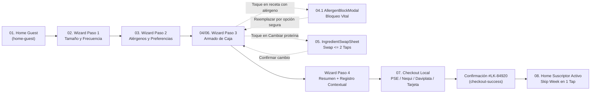

# ListoBox PWA — Suscripción Semanal de Meal-Kits


> **Tu semana gourmet sin esfuerzo.** Progressive Web App (*Mobile-First*) para la suscripción flexible de *meal-kits* con ingredientes frescos dosificados al gramo y recetas listas en 20–25 minutos, diseñada para el mercado colombiano bajo una arquitectura **Value-First (*Guest Mode*)**.

---

## Tabla de Contenidos

1. [Visión General y Propuesta de Valor](#1-visión-general-y-propuesta-de-valor)
2. [Inicio Rápido (Quick Start)](#2-inicio-rápido-quick-start)
3. [Características Principales y Matriz Funcional](#3-características-principales-y-matriz-funcional)
4. [Flujo de Usuario y Arquitectura de Pantallas](#4-flujo-de-usuario-y-arquitectura-de-pantallas)
5. [Guía de Prueba Rápida (Demo Walkthrough)](#5-guía-de-prueba-rápida-demo-walkthrough)
6. [Stack Tecnológico y Decisiones de Arquitectura](#6-stack-tecnológico-y-decisiones-de-arquitectura)
7. [Estructura del Proyecto](#7-estructura-del-proyecto)
8. [Sistema de Diseño ("Sweetgreen Farm-Stand")](#8-sistema-de-diseño-sweetgreen-farm-stand)
9. [Invariantes de Ingeniería y Control de Calidad](#9-invariantes-de-ingeniería-y-control-de-calidad)
10. [Documentación de Referencia](#10-documentación-de-referencia)

---

## 1. Visión General y Propuesta de Valor

**ListoBox** elimina la fricción de planificar cenas semanales, mercar y desperdiciar alimentos frescos. A diferencia de los modelos de suscripción tradicionales que imponen un muro de registro o pago antes de mostrar el catálogo (*login wall*), ListoBox implementa un flujo **Guest-First**:

* **Exploración Abierta (*Zero-Friction Discovery*):** Navegación libre por el catálogo semanal, filtros dietéticos y calculadora financiera sin exigir cuenta previa.
* **Seguridad Alimentaria Síncrona:** Motor preventivo de cruce de alérgenos (`vetoedAllergens`) que bloquea en tiempo real platos de riesgo vital y ofrece sustitución segura en 1 tap.
* **Personalización Modular en $\le 2$ Taps (*Swap Engine*):** Intercambio de proteínas y guarniciones con recálculo optimista (*Optimistic UI*) de calorías, gramos de proteína y sobrecostos en pesos colombianos (`COP`).
* **Conversión Contextual y Pagos Locales:** Transición *Guest-to-User* preservando íntegramente el estado en `localStorage` (`listobox_mvp_state_v2`), checkout con métodos de pago colombianos (**Tarjeta, PSE, Nequi, Daviplata**) y gestión posventa con pausa semanal (*Skip Week*) en 1 tap.

---

## 2. Inicio Rápido (Quick Start)

### Requisitos Previos
* **Node.js:** `>= 20.0.0` (LTS recomendado)
* **npm:** `>= 10.0.0`

### Instalación y Ejecución Local

```bash
# 1. Clonar el repositorio y entrar al directorio
git clone <url-del-repositorio>
cd pwa_listobox

# 2. Instalar dependencias
npm install

# 3. Iniciar el servidor de desarrollo
npm run dev
```

Abre **[http://localhost:3000](http://localhost:3000)** en tu navegador. La aplicación se renderiza dentro del contenedor ergonómico `MobileShell` (`max-w-md mx-auto min-h-dvh`), listo para inspección tanto en escritorio como en dispositivos móviles.

### Scripts Disponibles

| Comando | Propósito |
| :--- | :--- |
| `npm run dev` | Inicia el servidor de desarrollo de Next.js 15 en `http://localhost:3000`. |
| `npm run build` | Genera la compilación optimizada de producción y valida tipos e integridad de rutas. |
| `npm run start` | Sirve la compilación de producción generada en `.next/`. |
| `npm run lint` | Ejecuta el análisis estático con ESLint sobre el código fuente. |
| `npx tsc --noEmit` | Verifica el tipado estático estricto de TypeScript sin emitir archivos (requisito de DoD: `0 errores`). |

---

## 3. Características Principales y Matriz Funcional

| Módulo | Capacidad Implementada | Historia PRD | Componentes Clave |
| :--- | :--- | :---: | :--- |
| **Modo Invitado (*Guest-First*)** | Exploración abierta del menú semanal, propuesta de valor en 3 pasos, calculadora de ahorro y FAQ sin *login wall*. | `HU-01` | `HomeGuestScreen.tsx`, `FaqAccordion.tsx` |
| **Configurador de Plan** | Calibración de tamaño de hogar (`1`, `2`, `4`, `6` personas) y frecuencia (`3`, `4`, `5` recetas/semana) con recálculo dinámico en `COP`. | `HU-01` | `WizardStep1Screen.tsx`, `SelectableCard.tsx` |
| **Filtro de Alérgenos y Preferencias** | Exclusión de 8 alérgenos críticos, opción rápida *"Sin alergias"*, afinidades proteicas y límite de tiempo de cocción. | `HU-02` | `WizardStep2Screen.tsx` |
| **Bloqueo Preventivo Vital** | Cruce síncrono de recetas contra `vetoedAllergens`. Estado `Locked-Allergen` y modal intrusivo con reemplazo seguro en 1 tap. | `HU-02` | `AllergenBlockModal.tsx`, `RecipeCard.tsx` |
| **Motor de *Swap* ($\le 2$ Taps)** | *Bottom Sheet* para intercambiar proteínas o guarniciones con impacto en vivo sobre macros (`kcal`, `g` proteína) y precio en `COP`. | `HU-03` | `IngredientSwapSheet.tsx` |
| **Cuota de Caja y Sticky Dock** | Control estricto de cupo (`selectedSlots.length === mealsPerWeek`), indicadores de progreso y subtotal flotante. | `HU-04` | `WizardStep3Screen.tsx`, `StickyBoxDock.tsx` |
| **Registro Contextual (*Guest-to-User*)** | Alta rápida (Google, WhatsApp o PIN móvil), aplicación de cupón `COSECHA15` (15% DTO) y preservación total del estado de la caja. | `HU-05` | `WizardStep4Screen.tsx` |
| **Checkout Local Colombiano** | Captura de dirección de entrega, ventana horaria y pago recurrente simulado vía **Tarjeta, PSE, Nequi o Daviplata**. | `HU-06` | `CheckoutScreen.tsx`, `CheckoutSuccessScreen.tsx` |
| **Panel de Suscriptor Activo** | Orden confirmada `#LK-84920`, recordatorio de *cut-off* semanal y botón **Pausar semana / Reactivar (*Skip Week*)** en 1 tap. | `HU-07` | `HomeActiveScreen.tsx`, `BoxProgressSummary.tsx` |

---

## 4. Flujo de Usuario y Arquitectura de Pantallas

El estado global y la transición entre las 8 vistas del flujo (`ScreenId`) son gobernados por `ListoBoxContext.tsx` mediante `useReducer` y persistidos automáticamente en `localStorage`:



---

## 5. Guía de Prueba Rápida (Demo Walkthrough)

Para evaluar todos los casos de uso críticos del MVP en menos de 2 minutos:

1. **Explorar como Invitado (`HomeGuestScreen`):** Revisa el carrusel de recetas semanales, filtra por categorías dietéticas y pulsa **"Personalizar mi caja"**.
2. **Configurar Plan (`WizardStep1Screen`):** Selecciona **2 Personas** y **3 Comidas por semana**. Observa el cálculo automático por porción en `COP` y pulsa **"Continuar"**.
3. **Activar Bloqueo Médico (`WizardStep2Screen`):** Desmarca *"Sin alergias"* y selecciona el alérgeno **Mariscos (Crustáceos)** o **Maní (Cacahuate)**. Pulsa **"Continuar"**.
4. **Probar Seguridad de Alérgenos y *Swap* (`WizardStep3Screen`):**
   * Intenta agregar una receta marcada con alerta roja (`Bloqueada por tu filtro de...`): se abrirá inmediatamente el **`AllergenBlockModal`**, permitiendo sustituirla en 1 tap por una alternativa segura.
   * En cualquier receta seleccionada, pulsa **"Cambiar proteína"** para abrir el **`IngredientSwapSheet`**, elige una proteína premium y verifica la actualización instantánea de calorías y sobrecosto en el **`StickyBoxDock`**.
   * Completa la cuota de `3 de 3 recetas` para habilitar el botón **"Confirmar y continuar"**.
5. **Convertir Cuenta y Pagar (`WizardStep4Screen` $\rightarrow$ `CheckoutScreen`):** Verifica el descuento del cupón `COSECHA15`, vincula tu cuenta rápida (WhatsApp/Google/PIN), selecciona **Nequi** o **PSE** y confirma el pedido `#LK-84920`.
6. **Gestionar Suscripción (`HomeActiveScreen`):** En el panel de usuario activo, prueba el botón **"Pausar semana"** (*Skip Week*) y verifica cómo el estado persiste al recargar el navegador (`F5`).

> **Tip de depuración:** Si deseas reiniciar la simulación desde cero, ejecuta `localStorage.removeItem("listobox_mvp_state_v2")` en la consola del navegador o usa el control de reinicio de flujo.

---

## 6. Stack Tecnológico y Decisiones de Arquitectura

| Capa | Tecnología | Justificación Técnica |
| :--- | :--- | :--- |
| **Framework & UI** | Next.js 15.3 (App Router) + React 19 | Renderizado moderno, optimización de fuentes con `next/font/google` y separación limpia de layout y vistas cliente. |
| **Tipado Estático** | TypeScript 5.7 (`strict: true`) | Contratos de dominio estrictos en `src/types/listobox.ts` (`Recipe`, `AllergenId`, `WizardState`, `ScreenId`). Cero uso de `any`. |
| **Sistema de Estilos** | Tailwind CSS v4.1 (CSS-First) | Configuración unificada mediante `@theme` en `src/app/globals.css`, sin archivos `tailwind.config.js` heredados ni valores arbitrarios. |
| **Estado y Persistencia** | React Context + `useReducer` + `localStorage` | Sincronización determinista bajo la clave `listobox_mvp_state_v2` que garantiza hidratación segura y transición *Guest-to-User* sin pérdida de datos. |
| **Iconografía** | `@phosphor-icons/react` (`^2.1.10`) | Librería única de iconos vectoriales con declaración explícita de `weight` y `size` para consistencia visual. |

---

## 7. Estructura del Proyecto

```text
pwa_listobox/
├── AGENTS.md                                  # Control central, invariantes y reglas del proyecto
├── README.md                                  # Documentación principal del repositorio
├── package.json                               # Dependencias y scripts de automatización
├── tsconfig.json                              # Configuración estricta de TypeScript
├── public/
│   └── manifest.json                          # Web App Manifest para instalación PWA en móvil
├── contexto/                                  # Sistema de memoria persistente y decisiones (ADR)
│   ├── AGENTS.md                              # Espejo de reglas e invariantes
│   ├── decisiones.md                          # Índice ejecutivo de decisiones (D-01 a D-07)
│   ├── design.md                              # Tokens de color, tipografía y escala 1:1 px
│   ├── reglas.md                              # Líneas rojas verificables de ingeniería y diseño
│   ├── decisions/                             # Registros detallados de arquitectura y UX
│   ├── gotchas/                               # Trampas técnicas conocidas y soluciones probadas
│   ├── skills/                                # Procedimientos reutilizables de mantenimiento
│   └── state/                                 # Snapshot actual del proyecto (actual.md)
├── docs/                                      # Especificaciones de producto y diseño fuente
│   ├── DESIGN.md                              # Sistema de diseño original
│   ├── PRD.md                                 # Product Requirements Document (v2.0)
│   └── figma-refs/                            # Capturas oficiales de referencia UI (01 a 08)
└── src/
    ├── app/
    │   ├── fonts.ts                           # Carga optimizada de Plus Jakarta Sans
    │   ├── globals.css                        # Tokens @theme (Tailwind v4) y escala 1:1 px
    │   ├── layout.tsx                         # Root Layout, metadata PWA y ListoBoxProvider
    │   └── page.tsx                           # Orquestador de pantallas y modales globales
    ├── components/
    │   ├── screens/                           # Las 8 pantallas principales del flujo de usuario
    │   │   ├── HomeGuestScreen.tsx
    │   │   ├── WizardStep1Screen.tsx
    │   │   ├── WizardStep2Screen.tsx
    │   │   ├── WizardStep3Screen.tsx
    │   │   ├── WizardStep4Screen.tsx
    │   │   ├── CheckoutScreen.tsx
    │   │   ├── CheckoutSuccessScreen.tsx
    │   │   └── HomeActiveScreen.tsx
    │   └── ui/                                # Componentes modulares reutilizables (DRY)
    │       ├── AllergenBlockModal.tsx         # Modal de bloqueo médico y sustitución en 1 tap
    │       ├── IngredientSwapSheet.tsx        # Bottom Sheet de intercambio de proteínas/guarniciones
    │       ├── MobileShell.tsx                # Contenedor móvil (max-w-md, safe-area-inset)
    │       ├── StickyBoxDock.tsx              # Barra inferior de cupo y subtotal en COP
    │       ├── RecipeCard.tsx                 # Tarjeta de receta con 5 estados visuales
    │       ├── PillButton.tsx                 # Botón píldora accesible (min 44x44px)
    │       ├── TopNav.tsx / BottomNav.tsx     # Navegación contextual superior e inferior
    │       └── ...                            # Badges, filtros, acordeón FAQ, PullToRefresh, etc.
    ├── context/
    │   └── ListoBoxContext.tsx                # Reducer central, cálculos COP y sincronización local
    ├── mocks/
    │   └── listoboxData.ts                    # Catálogo de recetas, swaps, alérgenos y FAQs
    └── types/
        └── listobox.ts                        # Contratos e interfaces TypeScript
```

---

## 8. Sistema de Diseño ("Sweetgreen Farm-Stand")

La interfaz sigue una estética editorial orgánica, limpia y 100% plana (sin gradientes decorativos, sombras de neón ni *glassmorphism*). Todos los tokens están declarados en `src/app/globals.css`:

### Paleta Cromática Principal

| Token CSS | Clase Tailwind | Hex | Rol Semántico |
| :--- | :--- | :---: | :--- |
| `--color-cream-canvas` | `bg-cream-canvas` | `#f4f3e7` | Lienzo base cálido de toda la PWA |
| `--color-deep-forest` | `bg-deep-forest` / `text-deep-forest` | `#00473c` | Color primario de marca, titulares y bordes activos |
| `--color-lime-glow` | `bg-lime-glow` | `#e6ff55` | Acento de alta energía para CTAs principales (siempre con texto `#0e150e`) |
| `--color-sage-mist` | `bg-sage-mist` | `#d8e5d6` | Bandas informativas botánicas y chips secundarios |
| `--color-warm-sand` | `bg-warm-sand` | `#e8dcc6` | Contenedores secundarios, divisores y placeholders |
| `--color-surface-card` | `bg-surface-card` | `#efeee4` | Superficie de tarjetas en selectores y Checkout |
| `--color-forest-shadow` | `text-forest-shadow` | `#0e150e` | Texto principal de máximo contraste |
| `--color-danger-red` | `text-danger-red` / `bg-danger-light` | `#dc2626` | Semántica de alerta médica y bloqueo de alérgenos |

### Convención Crítica de Espaciado (`1:1 px`)
En `src/app/globals.css`, la escala `--spacing-N` está mapeada **1 a 1 en píxeles** (`p-16` = `16px`, `mt-24` = `24px`, `h-180` = `180px`), con la **única excepción** de `--spacing-11: 44px`, utilizada mediante `min-h-11 min-w-11` para garantizar áreas táctiles mínimas de `44x44px`.

---

## 9. Invariantes de Ingeniería y Control de Calidad

Todo cambio o extensión sobre el repositorio debe respetar las siguientes reglas verificables (detalladas en [`contexto/reglas.md`](contexto/reglas.md)):

1. **Ergonomía Táctil WCAG AA:** Todo control interactivo (`button`, `input`, chip, tab, enlace) incluye obligatoriamente `min-h-11 min-w-11` ($\ge 44\times 44\text{ px}$).
2. **Cero Clases Arbitrarias:** Prohibido el uso de valores entre corchetes en Tailwind (ej. `bg-[#...]`, `text-[13px]`), salvo `pt-[env(safe-area-inset-top)]` y `pb-[env(safe-area-inset-bottom)]`.
3. **Iconografía Estricta:** Uso exclusivo de `@phosphor-icons/react` declarando siempre `weight` y `size` explícitos; cero `<svg>` manuales o emojis como iconos de interfaz.
4. **Seguridad de Alérgenos Innegociable:** Ninguna receta que interseque con `state.vetoedAllergens` puede añadirse a `state.selectedSlots`; al seleccionarla en el Paso 2 se purga automáticamente de la caja si ya estaba agregada.
5. **Cuota Exacta del Plan:** El paso de confirmación de caja (`StickyBoxDock`) permanece deshabilitado hasta que `selectedSlots.length === mealsPerWeek`.

---

## 10. Documentación de Referencia

El proyecto cuenta con documentación modular tanto para desarrolladores como para agentes de IA:

* **[`AGENTS.md`](AGENTS.md):** Punto de entrada de control central, reglas duras y Definition of Done (DoD).
* **[`contexto/state/actual.md`](contexto/state/actual.md):** Estado vivo del proyecto (implementado, mejoras y blockers).
* **[`contexto/decisiones.md`](contexto/decisiones.md):** Resumen de decisiones arquitectónicas y de producto (`D-01` a `D-07`).
* **[`contexto/design.md`](contexto/design.md) y [`contexto/reglas.md`](contexto/reglas.md):** Referencia rápida de tokens UI y prohibiciones verificables.
* **[`docs/PRD.md`](docs/PRD.md) y [`docs/DESIGN.md`](docs/DESIGN.md):** Especificaciones originales de producto, historias de usuario BDD y guía visual.
* **[`docs/figma-refs/`](docs/figma-refs/):** Capturas oficiales de alta fidelidad que respaldan las 8 pantallas y modales del prototipo.

---

**Desarrollado para la Prueba Técnica Interrapidísimo — MVP v2.0.0 (Octubre 2026).**
